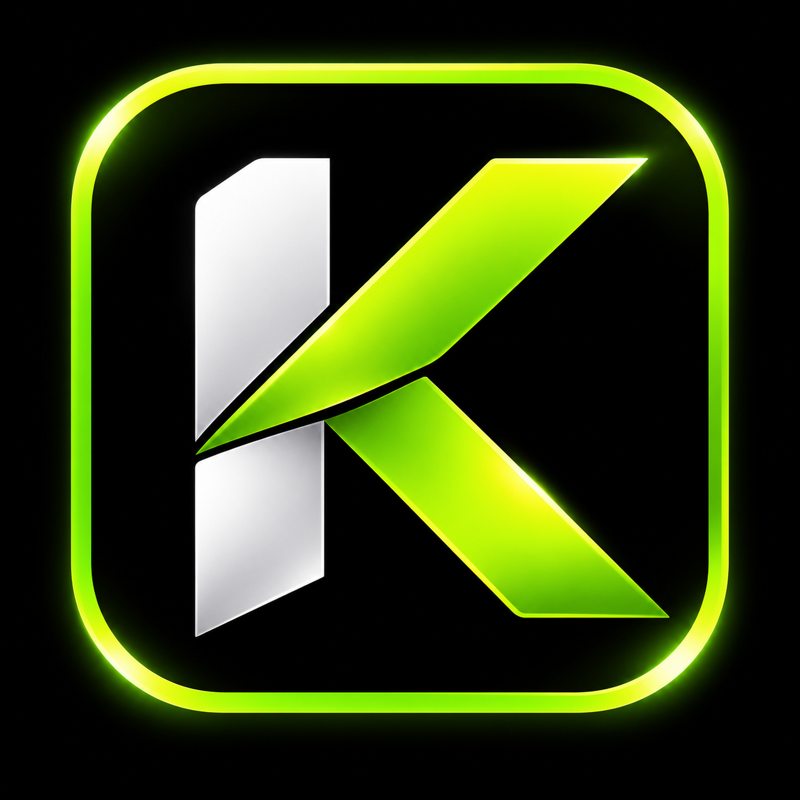

<div align="center">

  

  # Kavinda Malwewa

  ### IT Undergraduate · Aspiring AI/ML Engineer · Software Engineering · QA

  A thoughtful personal portfolio for sharing practical projects, technical
  interests, and the work behind them.

  <p>
    <a href="https://github.com/kavindamalwewa">GitHub</a>
    ·
    <a href="https://www.linkedin.com/in/kavinda-malwewa-0582b130/">LinkedIn</a>
    ·
    <a href="mailto:kavindamalwewa99@gmail.com">Email</a>
  </p>

  <p>
    
    
    
    
  </p>

</div>

## About the portfolio

This site is more than a resume page. It is a small, responsive product designed
to communicate how I think, what I build, and where I am growing.

The experience brings together:

- **A focused hero** with role highlights, social links, and a downloadable CV
- **An editorial about section** with background, quick facts, and milestones
- **A structured skills map** covering development, AI/ML, cloud, and QA
- **Project case studies** with goals, features, technologies, and contributions
- **Education and achievements** presented alongside the work they support
- **A contact experience** with copyable details and a working message form

## Featured work

| Project | Focus | What it explores |
| --- | --- | --- |
| **FloorPlan AI** | Computer vision · AI/ML · React | Detecting architectural elements and turning 2D floor plans into usable interior layouts |
| **Sparkshift** | Python · Algorithms · Rule-based systems | Generating, validating, and scoring furniture arrangements |
| **Plant Growth Monitor** | Image processing · Computer vision | Measuring growth and estimating plant health from images |
| **FitNote** | Web application · Fitness | Tracking fitness activities through a focused user experience |
| **Image Classifier** | Machine learning | Applying image classification techniques to a practical problem |
| **Personal Organizer** | Productivity · Web application | Organizing everyday tasks and information |
| **2D Browser Game** | JavaScript · Interaction | Building an engaging browser-based game experience |

## Design and engineering details

- Dark-first visual language with a light-mode toggle and persisted preference
- Responsive layout built around small, reusable component styles
- Inline SVG icon system with no icon-package dependency
- GSAP and ScrollTrigger for purposeful entrance and scroll motion
- Lenis for smooth scrolling, with motion disabled for reduced-motion users
- Mobile navigation with focusable controls, Escape-to-close, and scroll locking
- Semantic landmarks, accessible labels, visible states, and reduced visual noise
- Generated project artwork with support for real cover images in `public/projects/`

## Built with

| Layer | Tools |
| --- | --- |
| UI | React 19, JSX |
| Build | Vite 8 |
| Styling | Hand-written CSS, shared design tokens, responsive media queries |
| Motion | GSAP, ScrollTrigger, Lenis |
| Icons | Inline SVG components in `src/components/icons/BrandIcons.jsx` |
| Contact delivery | Web3Forms |
| Quality | ESLint 10, React Hooks rules |

## Run locally

### Requirements

- Node.js 18 or newer
- npm

### Setup

```bash
git clone https://github.com/kavindamalwewa/kavinda_portfolio.git
cd kavinda_portfolio
npm install
npm run dev
```

The development server starts with hot module replacement. Open the local URL
shown by Vite in your browser.

### Useful commands

```bash
npm run dev      # start the development server
npm run lint     # check the project with ESLint
npm run build    # create the production bundle in dist/
npm run preview  # preview the production build locally
```

## Project map

```text
public/
├── favicon2.png                 site and navbar logo
├── Kavinda-Malwewa-CV.pdf       downloadable CV
└── projects/                    project cover images

src/
├── components/                  page sections and their styles
│   ├── icons/BrandIcons.jsx     reusable inline SVG icons
│   └── ProjectArt.jsx           generated project cover artwork
├── data/socials.js              shared GitHub and LinkedIn links
├── hooks/useTheme.js             persisted dark/light theme
├── motion/                      animation and smooth-scroll helpers
├── App.jsx                      page composition and CV path
└── index.css                    tokens, reset, and global utilities
```

## Customization notes

- Replace `public/Kavinda-Malwewa-CV.pdf` to update the downloadable CV.
- Update profile URLs in `src/data/socials.js`; the hero and contact sections
  share this single source.
- Edit project content in `src/components/Projects.jsx`.
- Add a real project image under `public/projects/` and set its `cover` path to
  replace generated artwork.
- The contact form uses a public Web3Forms access key by design. Replace it with
  your own registered key if you fork this project.

## Connect

Interested in AI/ML, software engineering, quality assurance, or building
useful products together?

- **GitHub:** [kavindamalwewa](https://github.com/kavindamalwewa)
- **LinkedIn:** [Kavinda Malwewa](https://www.linkedin.com/in/kavinda-malwewa-0582b130/)
- **Email:** [kavindamalwewa99@gmail.com](mailto:kavindamalwewa99@gmail.com)

---

<div align="center">
  Built with curiosity, care, and a bias toward learning by building.
</div>
